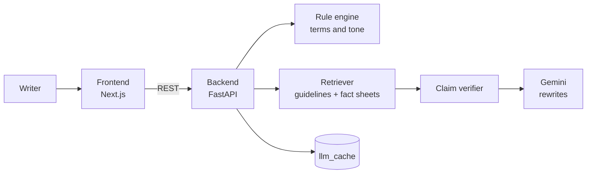

   <p align="center"></p>

#  TrueMark

### Fact-grounded brand governance, before you hit publish.

Check marketing copy against your brand guidelines and approved facts. Every finding cites the exact rule or source, and every fix keeps your voice.

[**▶ Live demo**](https://truemark-apex.surge.sh) · [**API health**](https://truemark-m9nt.onrender.com/health)


**Team APEX** · Inkloom AI Hackathon · Track: Pre-Publish Brand & Claim Intelligence

</div>

---

## 🎯 The problem

Marketing copy now comes from distributed teams, agencies and generative AI, all at high speed. That creates three problems:

- **Brand drift.** Tone, terminology and visual identity slowly move away from the brand book.
- **Unverified claims.** Lines like "fastest on the market" or "100% SLA guarantee", outdated pricing and AI hallucinations get published and expose the company to legal risk.
- **The reviewer bottleneck.** Manual sign-off takes days, and old-style linters reject drafts without explaining why or offering a way forward.

## 💡 What TrueMark does

TrueMark is an explainable co-pilot that sits between the writer and the publish button. It checks a draft two ways at once: with fast **deterministic rules**, and with **fact-grounded semantic retrieval (RAG)** against your approved guidelines and fact sheets.

| | |
|---|---|
| 🔎 **Explainable findings** | Nothing is flagged arbitrarily. Each finding cites the exact guideline clause or source passage behind it. |
| 🧾 **Claim verification** | Factual claims are compared against approved ground truth, so unverified superlatives, outdated numbers and hallucinations are caught. |
| ✍️ **Intent-preserving rewrites** | Instead of just rejecting copy, TrueMark offers 2-3 compliant rewrites that keep the writer's voice and goal. |
| 🖱️ **Human in control** | Authors accept, edit or ignore each suggestion. The tool advises and never dictates. |
| 🎨 **Image palette check** | Checks an asset's dominant colours against the brand's hex codes. |
| 📄 **Exportable report** | Download the audit as a report to share with a reviewer. |

## 🧪 Try it in 60 seconds

1. Open the [live demo](https://truemark-apex.surge.sh). A sample draft is already loaded.
2. Press **Check this copy**.
3. Click any marked passage or finding to see the rule or source it cites.
4. Apply a suggested rewrite, or edit the text yourself.
5. Download the report.

> The free server sleeps when idle. If the page says it's waking up, wait about a minute and it will continue by itself.

## 🧱 Architecture



**Two-pass pipeline**

1. **Retrieval and verification.** The draft is split into individual assertions. For each one, the retriever pulls the closest guideline excerpts and facts, and the verifier returns a status (verified, unverified claim, or guideline violation) with the cited source.
2. **Intent-preserving remediation.** For each problem, the rewriter gets the offending sentence, the cited rule and the original intent, and changes only the violating part so the voice survives.

Because the verifier is bound to retrieved sources, it can't invent policy justifications.

## ✅ Progress since Round 1

Everything promised in the Round 1 plan is built and running.

| Round 1 plan | Status |
|---|---|
| Guideline and fact ingestion (retrieval over brand rules and approved facts) | ✅ Done |
| Tone and terminology linter | ✅ Done |
| Grounded claim and fact verifier, with citations | ✅ Done |
| Intent-preserving rewriter (multiple options) | ✅ Done |
| Interactive findings view with one-click fixes | ✅ Done |
| Core workflow: ingest → audit → cite → fix → export | ✅ Done |
| Image palette hex validator | ✅ Done |
| Live public demo and GitHub repository | ✅ Done |
| Reliability: timeouts, retries, health check and cached samples | ➕ Added |

## 🛣️ Planned improvements (Round 3)

These three upgrade TrueMark from a single-draft checker into a governance system.

### 1. Governance Friction Dashboard
**Problem:** Brand teams can't see *which* rules are broken most or where the guidelines themselves are unclear.
**Plan:** Aggregate past audits into trends: the top breached rules, recurring violations by team, and rules that are often overridden (a sign of ambiguity).
**Result:** Governance shifts from policing individual drafts to fixing the guidelines and training writers.

### 2. Robust ingestion and multilingual handling
**Problem:** Real guideline files are messy: scanned or malformed PDFs, tables, and copy in more than one language.
**Plan:** Add layout-aware PDF parsing with OCR fallback, structured table and numeric-rule extraction, language detection, and multilingual retrieval, with clear errors when a file can't be read.
**Result:** TrueMark works on the documents companies actually have, with fewer silent failures.

### 3. Escalation, sign-off and audit trail
**Problem:** High-risk claims need a human approver, and legal teams need proof of who approved what.
**Plan:** Route unresolved high-risk findings to a manager for approval, and record every accept, edit, override and approval with a timestamp in an exportable audit log.
**Result:** A defensible record for compliance, and a faster path for edge cases.

## 📁 Repository layout

```
Truemark/
├── backend/
│   ├── app/              # FastAPI application
│   ├── data/             # Guidelines and approved fact sheets
│   ├── llm_cache/        # Cached LLM answers for the samples
│   ├── scripts/          # Helper scripts (e.g. warm_cache)
│   ├── tests/
│   ├── Dockerfile
│   ├── requirements.txt
│   └── .env.example
└── frontend/
    ├── app/              # Next.js App Router pages and styles
    ├── components/       # Findings, Library, Proof, Score
    ├── lib/api.js        # API client
    ├── next.config.mjs
    └── .env.example
```

## 🚀 Run it locally

You need **Python 3.12+**, **Node.js 18+** and a [Gemini API key](https://aistudio.google.com/).

**Backend**

```powershell
cd backend
python -m venv .venv
.venv\Scripts\activate
pip install -r requirements.txt
copy .env.example .env        # then add your GEMINI_API_KEY
uvicorn app.main:app --reload --port 8000
```

Check <http://localhost:8000/health>. It should show `"status":"ok"`.

**Frontend**

```powershell
cd frontend
npm install
copy .env.example .env.local  # NEXT_PUBLIC_API_URL=http://localhost:8000
npm run dev
```

Open <http://localhost:3000>.

## 🔧 Configuration

**Backend environment variables**

| Variable | Purpose | Example |
|---|---|---|
| `GEMINI_API_KEY` | Your Gemini key (secret, never commit it) | `AIza...` |
| `GEMINI_MODEL` | Exact model name from Google AI Studio | *(copy from AI Studio)* |
| `LLM_TIMEOUT_S` | Seconds to wait for Gemini | `30` |
| `LLM_MAX_RETRIES` | Retries on a failed LLM call | `1` |
| `RETRIEVER` | `tfidf` (light, fits 512 MB) or the default Chroma setup | `tfidf` |
| `CORS_ORIGINS` | Frontend address allowed to call the API, no trailing slash | `https://truemark-apex.surge.sh` |

**Frontend environment variable**

| Variable | Purpose | Example |
|---|---|---|
| `NEXT_PUBLIC_API_URL` | Address of the deployed API, no trailing slash | `https://truemark-m9nt.onrender.com` |

It's baked in at build time, so set it **before** `npm run build`.

## ☁️ Deployment

**Backend on Render (free tier)**

| Setting | Value |
|---|---|
| Root Directory | `backend` |
| Language | Python 3 |
| Build Command | `pip install -r requirements.txt` |
| Start Command | `uvicorn app.main:app --host 0.0.0.0 --port $PORT` |

**Frontend on Surge**

`frontend/next.config.mjs` is already set to static export:

```js
export default { reactStrictMode: true, output: "export" };
```

```powershell
cd frontend
$env:NEXT_PUBLIC_API_URL="https://YOUR-SERVICE.onrender.com"
npm run build
npm install -g surge
surge ./out your-name.surge.sh
```

Add your Surge address as `CORS_ORIGINS` on Render, or the page will load but report that it can't reach the server.

## 💡 Good to know

- **Free servers sleep.** Render's free tier sleeps after about 15 minutes idle, and waking takes around a minute. An uptime monitor pings `/health` every 5 minutes to keep it awake.
- **Warm the cache.** Run `python -m scripts.warm_cache` from `backend/` and commit the filled `llm_cache/` so the samples work even if Gemini is busy.
- **Never commit secrets.** `.env` and `.env.local` are git-ignored. Only the `.env.example` templates belong in the repo.

## 🔒 Responsible by design

Brand books and unpublished copy are sensitive, so TrueMark does not use your data to train any model. Every finding and rewrite is transparent, with the source shown. Publishing authority always stays with a human.

## 🛠️ Built with

- **Frontend:** Next.js 15 (App Router), React 19, plain JavaScript and CSS
- **Backend:** FastAPI, Uvicorn, TF-IDF / Chroma retrieval
- **AI:** Google Gemini
- **Hosting:** Render (API) and Surge (static site)

## 👤 Author

**Shlok Vijaykumar Yadav**, solo architect and developer, Team APEX
[GitHub](https://github.com/Shlokyadav-0315) · [LinkedIn](https://www.linkedin.com/in/shlok-yadav-tech)
