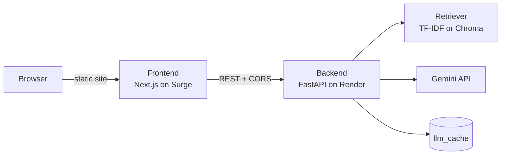

<div align="center">

# ✅ TrueMark

**Paste your copy. See what's wrong. Fix it in one click.**

An AI-assisted copy checker with a FastAPI backend and a Next.js frontend.

[**Live demo**](https://truemark-apex.surge.sh) · [**API health**](https://truemark-m9nt.onrender.com/health)


</div>

---

## ✨ What it does

1. **Check this copy**: paste text (or start from a built-in sample) and run an audit.
2. **See the problems**: risky or weak passages are marked right in the text, with a list of findings alongside.
3. **Understand why**: click any marked passage or finding to see the proof behind it.
4. **Fix it fast**: apply a suggested rewrite written by Gemini, or edit the text yourself.
5. **Take it with you**: download the report when you're done.

> If the AI is busy or unavailable, the app still works: you can edit the text by hand, and the cached sample drafts load without calling Gemini.

## 🧱 How it fits together



- The **frontend** is a static export, so it can be hosted anywhere that serves files.
- The **backend** runs the audit, retrieves reference material from `data/`, and asks Gemini for rewrites.
- **`llm_cache/`** stores pre-generated answers for the sample drafts, so demos work even when Gemini is slow.

## 📁 Repository layout

```
Truemark/
├── backend/
│   ├── app/              # FastAPI application
│   ├── data/             # Reference data used by the retriever
│   ├── llm_cache/        # Cached LLM answers for the samples
│   ├── scripts/          # Helper scripts (e.g. warm_cache)
│   ├── tests/
│   ├── Dockerfile
│   ├── requirements.txt
│   └── .env.example
└── frontend/
    ├── app/              # Next.js App Router pages and styles
    ├── components/       # Findings, Library, Proof, Score
    ├── lib/api.js        # API client
    ├── next.config.mjs
    └── .env.example
```

## 🚀 Run it locally

You need **Python 3.12+**, **Node.js 18+** and a [Gemini API key](https://aistudio.google.com/).

### 1. Backend

```powershell
cd backend
python -m venv .venv
.venv\Scripts\activate
pip install -r requirements.txt
copy .env.example .env        # then add your GEMINI_API_KEY
uvicorn app.main:app --reload --port 8000
```

Check it at <http://localhost:8000/health>. You should see `"status":"ok"`.

### 2. Frontend

```powershell
cd frontend
npm install
copy .env.example .env.local  # NEXT_PUBLIC_API_URL=http://localhost:8000
npm run dev
```

Open <http://localhost:3000>. The first sample is already loaded, so press **Check this copy** to try it.

## 🔧 Configuration

### Backend environment variables

| Variable | Purpose | Example |
|---|---|---|
| `GEMINI_API_KEY` | Your Gemini key (keep it secret, never commit it) | `AIza...` |
| `GEMINI_MODEL` | Exact model name from Google AI Studio | *(copy from AI Studio)* |
| `LLM_TIMEOUT_S` | Seconds to wait for Gemini | `15` (use `30` on cold starts) |
| `LLM_MAX_RETRIES` | Retries on a failed LLM call | `1` |
| `RETRIEVER` | `tfidf` (light, fits 512 MB) or the default Chroma setup | `tfidf` |
| `CORS_ORIGINS` | Frontend address allowed to call the API, no trailing slash | `https://truemark-apex.surge.sh` |

### Frontend environment variable

| Variable | Purpose | Example |
|---|---|---|
| `NEXT_PUBLIC_API_URL` | Address of the deployed API, no trailing slash | `https://truemark-m9nt.onrender.com` |

This value is baked in at build time, so set it **before** running `npm run build`.

## ☁️ Deployment

### Backend on Render (free tier)

| Setting | Value |
|---|---|
| Root Directory | `backend` |
| Language | Python 3 |
| Build Command | `pip install -r requirements.txt` |
| Start Command | `uvicorn app.main:app --host 0.0.0.0 --port $PORT` |
| Instance type | Free |

Add the environment variables from the table above, then deploy and open `/health` to confirm it's live.

### Frontend on Surge

`frontend/next.config.mjs` is already set to static export:

```js
export default { reactStrictMode: true, output: "export" };
```

```powershell
cd frontend
$env:NEXT_PUBLIC_API_URL="https://YOUR-SERVICE.onrender.com"
npm run build
npm install -g surge
surge ./out your-name.surge.sh
```

Finally, add your Surge address as `CORS_ORIGINS` on Render, or the page will load but report that it can't reach the server.

## 💡 Good to know

- **Free servers sleep.** Render's free tier sleeps after about 15 minutes without traffic, and waking it takes around a minute. The page keeps retrying `/health` and says the server is waking up. Before a demo, open `/health` yourself, or ping it every 5 minutes with a free uptime monitor.
- **Warm the cache.** Run `python -m scripts.warm_cache` from `backend/` and commit the filled `llm_cache/` folder so the samples work even if Gemini is busy.
- **Never commit secrets.** `.env` and `.env.local` are git-ignored. Only the `.env.example` templates belong in the repo.

## 🛠️ Built with

- **Frontend:** Next.js 15 (App Router), React 19, plain JavaScript and CSS
- **Backend:** FastAPI, Uvicorn, TF-IDF / Chroma retrieval
- **AI:** Google Gemini
- **Hosting:** Render (API) and Surge (static site)

## 👤 Author

Made by **Shlok Yadav** ([@Shlokyadav-0315](https://github.com/Shlokyadav-0315)).
